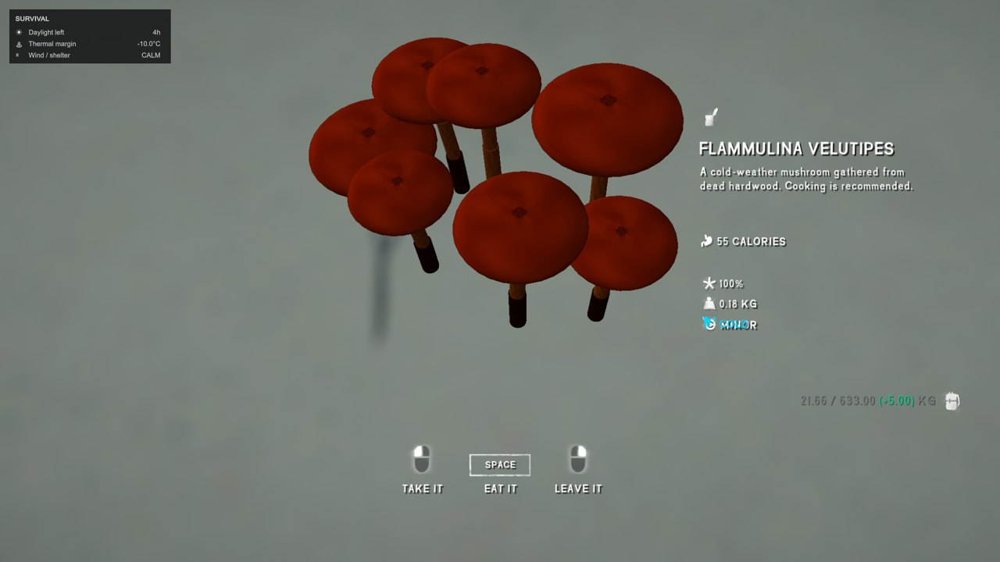
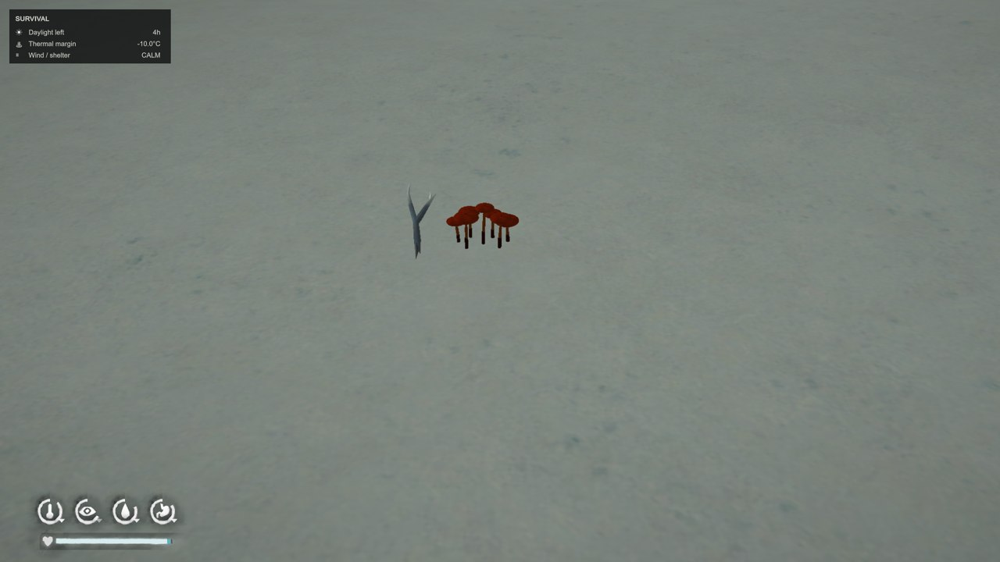
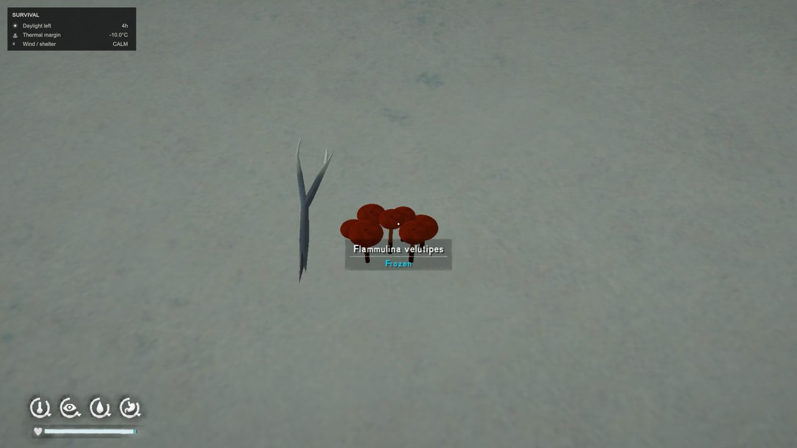
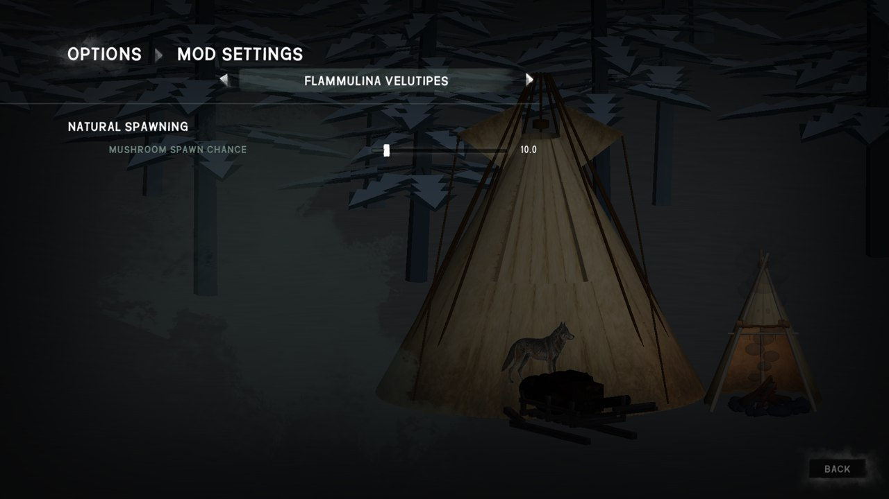

# Burebista Winter Mushrooms

**Flammulina velutipes · v0.4.4 · The Long Dark · Español / English**

[Descargar / Download](https://github.com/florynstefanache-source/BurebistaWinterMushrooms/releases/latest) · [English](#english)

## Español

Añade racimos de setas de invierno **Flammulina velutipes**, con modelos propios y versiones cruda y cocinada. Aparecen cerca de palos naturales y madera del bosque, con una probabilidad configurable. Los objetos, sus descripciones y los ajustes aparecen en español o inglés según el idioma del juego.

### Encontrar y cocinar

- Busca racimos cerca de palos naturales del bosque. La aparición no está garantizada en cada punto.
- El mod también busca puntos junto a palos que aún no hayas recogido al visitar regiones de partidas existentes. Espera unos diez segundos después de cargar la región; puede añadir hasta 12 racimos en esa pasada.
- **Se recomienda cocinar las setas en un recipiente de cocina compatible, como una olla o sartén, sobre el fuego.**
- Recoge las setas y cocínalas con el sistema normal del juego. El modelo se adapta a las ranuras de cocina y recupera su forma al retirarlo.
- El nombre científico se mantiene igual en ambos idiomas; la versión cocinada y las descripciones sí se traducen.

### Ajustes de aparición

Abre **Opciones → Mod Settings → FLAMMULINA VELUTIPES**.

| Español | English |
| --- | --- |
| APARICIÓN NATURAL | NATURAL SPAWNING |
| PROBABILIDAD DE APARECER SETAS | MUSHROOM SPAWN CHANCE |

El deslizador va de **0 a 100 %**, con **25 % por defecto**. La captura muestra un ajuste personal del **10 %**, no el valor por defecto. Tu valor guardado se conserva al actualizar. La explicación del ajuste también cambia con el idioma. Tras cambiar de idioma, vuelve a abrir el menú de ajustes.

### Instalación

1. Instala **MelonLoader, ModSettings y ModComponent**, con sus dependencias habituales.
2. Cierra The Long Dark y descarga `BurebistaWinterMushrooms-v0.4.4-ES-EN.zip` desde Releases.
3. Copia **los dos archivos** de la carpeta `Mods` del ZIP a `TheLongDark/Mods`:
   - `BurebistaWinterMushrooms.dll`
   - `BurebistaWinterMushrooms.modcomponent`
4. Sustituye los archivos anteriores y guarda las copias antiguas fuera de `Mods`.
5. **Conserva `BurebistaWinterMushrooms.json`** si ya existe: contiene tu configuración. El paquete no lo sobrescribe.
6. Inicia el juego y selecciona Español o English.

Es necesario actualizar el **.modcomponent además del DLL**, porque contiene los textos y recursos de las setas. No necesita el antiguo `BurebistaLanguages.dll`. El ZIP automático del repositorio no es el paquete de instalación.

### Versión 0.4.4

Completa la traducción de la sección, nombre y descripción de los ajustes usando el soporte de localización de ModSettings. Conserva modelos, comida, aparición y configuración de la versión 0.4.3. Compilación sin errores ni advertencias y 24 comprobaciones de traducción e integridad de recursos superadas. Las capturas de Burebista muestran el objeto y los ajustes en inglés dentro del juego.

## English

Adds **Flammulina velutipes winter mushroom clusters**, with custom models and raw/cooked versions. They spawn near natural sticks and woodland timber with a configurable probability. Item names, descriptions and settings follow the selected game language: Spanish or English.

### Finding and cooking

- Look for clusters near naturally spawned woodland sticks. A cluster is not guaranteed at every point.
- Existing-save regions are supported: after loading a region, the mod waits about ten seconds and checks untouched natural sticks, adding up to 12 clusters in that pass.
- **For best results, cook the mushrooms in a compatible cooking vessel, such as a pot or skillet, over a fire.**
- Collect mushrooms and cook them using the normal cooking system. Their model adjusts to cooking slots and returns to its normal shape when removed.
- The scientific name is identical in both languages; the cooked item name and descriptions are translated.

### Spawn settings

Open **Options → Mod Settings → FLAMMULINA VELUTIPES**. The **NATURAL SPAWNING** section contains **MUSHROOM SPAWN CHANCE** and its localized description. Spanish displays **APARICIÓN NATURAL** and **PROBABILIDAD DE APARECER SETAS**.

The slider ranges from **0 to 100%**, with a **25% default**. The screenshot shows Burebista's personal **10%** setting, rather than the default. Updates preserve your saved value. Reopen settings after changing the game language.

### Installation

1. Install **MelonLoader, ModSettings and ModComponent**, with their usual dependencies.
2. Close The Long Dark and download `BurebistaWinterMushrooms-v0.4.4-ES-EN.zip` from Releases.
3. Copy **both files** inside the ZIP's `Mods` folder into `TheLongDark/Mods`: `BurebistaWinterMushrooms.dll` and `BurebistaWinterMushrooms.modcomponent`.
4. Replace the previous files and store backups outside `Mods`.
5. **Keep your existing `BurebistaWinterMushrooms.json`** configuration. The package does not overwrite it.
6. Launch the game and select English or Spanish.

Update the **.modcomponent as well as the DLL**: it contains mushroom resources and localized text. The old `BurebistaLanguages.dll` is not required. Use the installable release ZIP rather than GitHub's automatic repository archive.

### Version 0.4.4

Completes localization of the settings section, option name and description through ModSettings' localization support. Preserves version 0.4.3 models, food, spawning and saved configuration. Builds without errors or warnings and passes 24 localization and asset-integrity checks. Burebista's screenshots show the item and settings in English in the game.

## Créditos / Credits

Mod y capturas: Burebista. Las capturas incluyen otros mods de su partida que no forman parte de este paquete. The Long Dark pertenece a Hinterland Studio; mod de aficionados no oficial.

Mod and screenshots: Burebista. Screenshots include other mods from their game that are not part of this package. The Long Dark belongs to Hinterland Studio; unofficial fan mod.